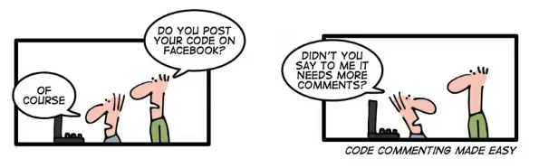
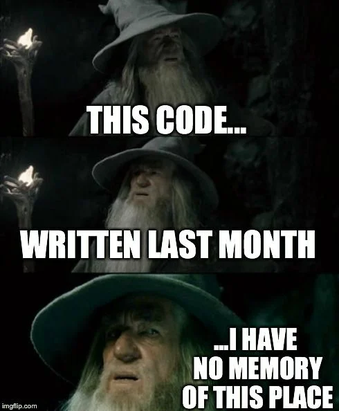
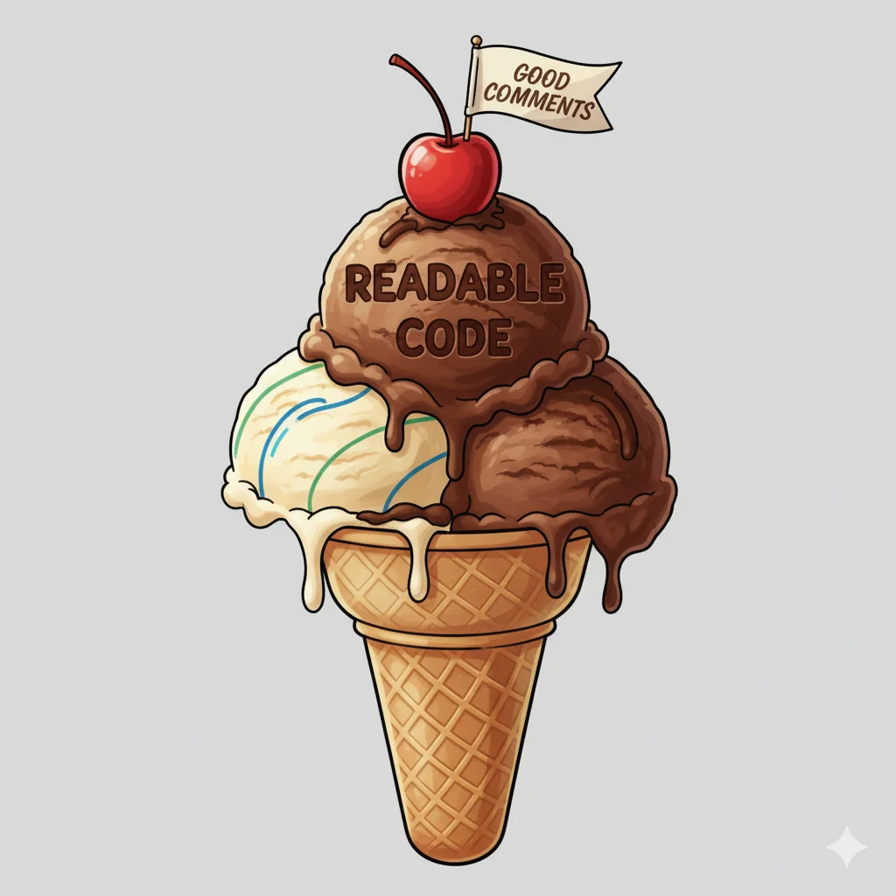

---
format:
  revealjs:
    css: style.css
    theme: simple
    revealjs-plugins:
      - a11y
    revealjs-a11y:
      # 0.2.3's menus introduce ARIA failures; retain our slide-menu handling.
      slide-menu-a11y: false
      menu: false
      # Use the extension's core accessibility fixes without extra UI/shortcuts.
      font-size-controls: false
      font-selection: false
      text-spacing: false
      transcript: false
      slide-change-cue: false
    slide-number: true
    code-line-numbers: false
    preview-links: auto
    keyboard: true
    touch: true
    help: true
    include-in-header: meta-tags.html
    include-after-body: accessibility.html
    link-external-newwindow: true
execute:
  echo: true
  eval: false
keywords: ["comments", "software-engineering", "computer-science", "software-development", "code-documentation"]
description-meta: "A comprehensive guide to code commenting best practices for software development. Learn when, how, and why to write effective comments that enhance code clarity and maintainability."
license: "CC0 1.0 Universal"
pagetitle: "To Comment or Not To Comment"
author-meta: "Indrajeet Patil"
date-meta: "2025-12-05"
lang: "en"
dir: "ltr"
image: "media/pipe.webp"
image-alt: "Preview image for presentation about code commenting best practices"
canonical-url: "https://www.indrapatil.com/to-comment-or-not/"
jupyter: python3
---

## To Comment or Not To Comment {style="margin-top: 1em; margin-bottom: 2.5em;"}

:::: {.columns}

::: {.column width="50%"}

::: {style="margin-top: 2em; padding: 1.5em 0;"}

::: {style="font-size: 0.9em; font-weight: bold;"}
Navigating the Art and Science of Code Comments
:::

::: {style="font-size: 0.8em; margin-top: 1em;"}
Indrajeet Patil
:::

:::

:::

::: {.column width="50%"}

::: {style="margin-top: 2em;"}

{width="100%" fig-alt="René Magritte's 'The Treachery of Images' painting showing a pipe with text 'Ceci n'est pas une pipe' (This is not a pipe)"}

:::

:::

::::

::: {.footer style="text-align: center; font-size: 0.55em; color: #666; position: absolute; bottom: 20px; left: 0; right: 0;"}
Source code: [github.com/IndrajeetPatil/to-comment-or-not](https://github.com/IndrajeetPatil/to-comment-or-not/){style="text-decoration: underline;"}
:::

::: {.notes}
- Welcome everyone to this session on code comments in software engineering.
- Highlight the visual metaphor on the right: René Magritte's "The Treachery of Images", reminding us that code and its representations are not the same thing.
- Set the stage: commenting is often treated as either a chore or an afterthought, but thoughtful commenting is an essential engineering discipline.
- Outline the goal: moving beyond dogmatic rules to establish practical, context-aware guidelines for maintainable code.
:::

## What You'll Learn {.smaller}

- Why commenting matters for code quality and maintainability
- When to comment and when not to comment
- Practical strategies for writing clear, helpful, and meaningful comments

<br>

::: {style="background-color: #FFFBC1; padding: 20px; border-radius: 25px; text-align: center;"}

🎯 **Goal**

Learning to write comments that clarify intent, not echo code.

:::

<br>

::: {style="background-color: #e3f2fd; padding: 20px; border-radius: 25px; text-align: center;"}

Despite Python examples, all the mentioned strategies are **language-agnostic**.<br>
None of this advice is **dogma**; there can be valid reasons and conventions to break these rules.

:::

::: {.notes}
- Walk through the three main learning pillars: understanding why comments matter, knowing when and when not to write them, and learning practical drafting strategies.
- Emphasise the core goal: learning to write comments that clarify intent, not merely echo the syntax.
- Remind the audience of the footnote: none of this advice is dogma, and conventions must always adapt to team and language context.
:::

# "The purpose of commenting is to help the reader know as much as the writer did."
\- Boswell & Foucher

::: {.notes}
- Pause on this foundational quotation from Dustin Boswell and Trevor Foucher's "The Art of Readable Code".
- Highlight the core insight: as the author, you possess immense mental context about edge cases, trade-offs, and domain constraints that cannot fit into syntax alone.
- The objective of commenting is closing that information gap for future maintainers.
:::

# Why Comments Matter

_Good comments act as guideposts for navigating complex code._

::: {.notes}
- Transition into the first major section of the presentation: Why Comments Matter.
- Frame comments as navigation guideposts across complex codebases.
- Introduce the recurring theme: clean architecture and expressive naming are prerequisites, but comments carry the reasoning behind decisions.
:::

## Why It's Challenging {.smaller}

Multiple pressures during development make thoughtful commenting difficult.

. . .

```{mermaid}
%%| eval: true
%%| echo: false
flowchart TD
    A[Deadline Pressure] --> D[High Cognitive Load]
    B[Complex Problem Solving] --> D
    C[Implementation Focus] --> D

    D --> E[Commenting Shortcuts]

    E --> F[No Comments]
    E --> G[Redundant Comments]
    E --> H[Obsolete Comments]

    style A fill:#E8EAF6,color:#000
    style B fill:#E8EAF6,color:#000
    style C fill:#E8EAF6,color:#000
    style D fill:#FFE082,color:#000
    style E fill:#FFCC80,color:#000
    style F fill:#FFAB91,color:#000
    style G fill:#FFAB91,color:#000
    style H fill:#FFAB91,color:#000
```

::: {.notes}
- Walk through the flowchart showing how developer pressures translate into poor commenting outcomes.
- Explain the causal chain: deadline pressure, intricate problem solving, and intense implementation focus create high cognitive load.
- Under cognitive load, developers take shortcuts: omitting comments entirely, copying redundant comments, or allowing existing comments to drift and become obsolete.
:::

## _N.B._ Documentation vs. Comments {.smaller}

:::: {.columns}

::: {.column width='65%'}

<div style="background-color: #f8f9fa; padding: 15px; border-radius: 8px; font-family: monospace; font-size: 0.75em; line-height: 1.6;">
<span style="color: #0033cc;">def</span> is_valid_email(email: str) -> bool:<br>
&nbsp;&nbsp;&nbsp;&nbsp;<span style="background-color: rgba(117, 112, 179, 0.3); padding: 2px 4px; border-radius: 3px; font-size: 0.95em;">"""Check if email address is valid.</span><br>
&nbsp;&nbsp;&nbsp;&nbsp;<br>
&nbsp;&nbsp;&nbsp;&nbsp;<span style="background-color: rgba(117, 112, 179, 0.3); padding: 2px 4px; border-radius: 3px; font-size: 0.95em;">Args:</span><br>
&nbsp;&nbsp;&nbsp;&nbsp;&nbsp;&nbsp;&nbsp;&nbsp;<span style="background-color: rgba(117, 112, 179, 0.3); padding: 2px 4px; border-radius: 3px; font-size: 0.95em;">email: Email address to validate</span><br>
&nbsp;&nbsp;&nbsp;&nbsp;<br>
&nbsp;&nbsp;&nbsp;&nbsp;<span style="background-color: rgba(117, 112, 179, 0.3); padding: 2px 4px; border-radius: 3px; font-size: 0.95em;">Returns:</span><br>
&nbsp;&nbsp;&nbsp;&nbsp;&nbsp;&nbsp;&nbsp;&nbsp;<span style="background-color: rgba(117, 112, 179, 0.3); padding: 2px 4px; border-radius: 3px; font-size: 0.95em;">True if valid, False otherwise</span><br>
&nbsp;&nbsp;&nbsp;&nbsp;<span style="background-color: rgba(117, 112, 179, 0.3); padding: 2px 4px; border-radius: 3px; font-size: 0.95em;">"""</span><br>
&nbsp;&nbsp;&nbsp;&nbsp;<span style="background-color: rgba(230, 171, 2, 0.3); padding: 2px 4px; border-radius: 3px; font-size: 0.95em;"># RFC 5322 simplified: local@domain format</span><br>
&nbsp;&nbsp;&nbsp;&nbsp;local_part = <span style="color: #008000;">r'[a-zA-Z0-9._%+-]+'</span><br>
&nbsp;&nbsp;&nbsp;&nbsp;domain = <span style="color: #008000;">r'[a-zA-Z0-9.-]+'</span><br>
&nbsp;&nbsp;&nbsp;&nbsp;tld = <span style="color: #008000;">r'[a-zA-Z]{2,}'</span><br>
&nbsp;&nbsp;&nbsp;&nbsp;<br>
&nbsp;&nbsp;&nbsp;&nbsp;pattern = <span style="color: #0033cc;">rf</span><span style="color: #008000;">'^{local_part}@{domain}\.{tld}$'</span><br>
&nbsp;&nbsp;&nbsp;&nbsp;<span style="color: #0033cc;">return</span> re.match(pattern, email) <span style="color: #0033cc;">is not</span> <span style="color: #0033cc;">None</span>
</div>

:::

::: {.column width='35%'}

::: {style="background-color: rgba(117, 112, 179, 0.2); padding: 10px; border-radius: 10px; margin-bottom: 10px;"}
**Documentation**

- How to *use* the function
- Parameters & returns
- For function *users*
- For public interface
:::

::: {style="background-color: rgba(230, 171, 2, 0.2); padding: 10px; border-radius: 10px;"}
**Comments**

- *Why* it works this way
- Business rules & context
- For code *maintainers*
- For private implementation
:::

:::

::::

::: {.notes}
- Clarify the crucial architectural distinction between API documentation and implementation comments.
- Use the code sample to contrast the docstring (which defines the public interface, parameters, and contract for callers) with the inline comment (which explains internal implementation quirks for maintainers).
- Walk through the comparison table covering audience, purpose, scope, and lifecycle.
:::

# What *Not* to Comment

_Every comment distracts from reading code—make sure it's worth the interruption._

::: {.notes}
- Transition to the next major section: What Not to Comment.
- Emphasise the guiding principle: every comment interrupts the reading flow of the code, so it must justify its cognitive cost.
- Reiterate that bad comments are often worse than no comments at all.
:::

## Don't use crutch comments {.smaller}

Fix the unclear code instead: $good code > bad code + comments$.

:::: {.columns}

::: {.column width='50%'}

:::{.callout-caution icon=false title="❌ Comment compensates for bad naming"}

```{python}
# Check if user can access premium features
def chk(u):
    return u.tier == 'gold' or u.tier == 'platinum'
```

:::

:::

::: {.column width='50%'}

:::{.callout-tip icon=false title="✅ Clear naming needs no comment"}

```{python}
def has_premium_access(user):
    return user.tier in ['gold', 'platinum']
```

:::

:::

::::

:::: {.columns}

::: {.column width='50%'}

:::{.callout-caution icon=false title="❌ Comment explains complex conditional"}

```{python}
# Process if positive and (even or divisible by 5)
if x > 0 and (x % 2 == 0 or x % 5 == 0):
    process(x)
```

:::

:::

::: {.column width='50%'}

:::{.callout-tip icon=false title="✅ Well-named function obviates comment"}

```{python}
def should_process(x):
    return x > 0 and (x % 2 == 0 or x % 5 == 0)

if should_process(x):
    process(x)
```

:::

:::

::::

::: {style="background-color: rgba(230, 171, 2, 0.15); border-left: 5px solid #E6AB02FF; padding: 20px; border-radius: 8px; font-size: 0.85em;"}

:::: {.columns}

::: {.column width='65%'}

**❌ Closing brace comments signal complexity**

Indicates overly complex, deeply nested code that needs refactoring into smaller, well-named functions (example from <span style="background-color: #e0e0e0; padding: 2px 8px; border-radius: 4px; font-weight: bold;">JavaScript</span>).

:::

::: {.column width='35%'}

::: {style="background-color: #ffffff; padding: 15px; border-radius: 8px; font-size: 0.75em;"}

```javascript
while (...) {
    try {
        for (...) {
            ...
        } // end for
    } catch {
        ...
    } // end try
} // end while
```

:::

:::

::::

:::

::: {.notes}
- Explain the concept of crutch comments: using comments as an apology or band-aid for obscure or poorly factored code.
- Contrast the two examples on the slide:
  - First, show how renaming `chk(u)` to `can_access_premium_features(user)` eliminates the need for an explanatory comment.
  - Second, show how extracting complex boolean expressions into descriptive predicates (`is_eligible = ...`) makes the code immediately self-documenting.
- Reiterate the mathematical formula at the top: good code is strictly better than bad code plus comments.
:::

## [Avoid duplicate comments]{.visually-hidden} {.smaller}

**Don't duplicate the code in comments**

:::: {.columns}

::: {.column width='50%'}

:::{.callout-caution icon=false title="❌ Bad"}

```{python}
# increment counter
counter += 1

# user name variable
user_name = "john"
```

:::

:::

::: {.column width='50%'}

:::{.callout-tip icon=false title="✅ Good"}

```{python}
# Reset retry count after successful connection
counter = 0

# Store normalised username for database
user_name = normalize(input)
```

:::

:::

::::

::: {.callout-note title="Why not 'Don't state the obvious?'"}

*Obvious* depends on your audience. Code clear to senior developers may confuse juniors.

Consider team experience when deciding what needs explanation.

:::

**Don't write non-local comments**

:::: {.columns}

::: {.column width='50%'}

:::{.callout-caution icon=false title="❌ Requires checking other files"}

```{python}
# See UserService for validation logic
user = create_user(data)
```

:::

:::

::: {.column width='50%'}

:::{.callout-tip icon=false title="✅ Self-contained explanation"}

```{python}
# Email validated before creation (RFC 5322)
# Duplicates rejected via unique constraint
user = create_user(data)
```

:::

:::

::::

::: {.notes}
- Address duplicate comments that merely parrot what the code clearly expresses.
- Contrast trivial code duplication (`counter += 1`) with meaningful explanations of state changes (`counter = 0` after connection).
- Walk through the lower pair on non-local comments: contrast vague pointers like "See UserService" with self-contained comments that document validation constraints (`RFC 5322`) and database invariants locally.
- Note the advisory callout: what is obvious depends on audience and team experience.
:::

## [Remove dead code and history]{.visually-hidden} {.smaller}

**Don't retain dead code as comments**

:::: {.columns}

::: {.column width='50%'}

:::{.callout-caution icon=false title="❌ Bad"}

```{python}
# old_function()
new_function()
```

:::

:::

::: {.column width='50%'}

:::{.callout-tip icon=false title="✅ Good"}

```{python}
new_function()
```

:::

:::

::::

**Don't narrate git history**

:::: {.columns}

::: {.column width='50%'}

:::{.callout-caution icon=false title="❌ Narrative changelog"}

```{python}
# Changed timeout from 5 to 10 on Jan 15
# Updated to 30 on Feb 3 for prod issue
# Reduced to 20 on Feb 10 per team discussion
timeout = 20
```

:::

:::

::: {.column width='50%'}

:::{.callout-tip icon=false title="✅ Point to commit/issue"}

```{python}
# Timeout tuned for production load
# See commit abc123f or issue #456
timeout = 20
```

:::

:::

::::

::: {style="background-color: #e3f2fd; padding: 10px; border-radius: 8px; margin: 10px 0; font-size: 0.8em; text-align: center;"}
**Exception**: Bundled/distributed code without git access may need key change notes in comments.
:::

**Don't confuse docs with comments**

:::: {.columns}

::: {.column width='50%'}

:::{.callout-caution icon=false title="❌ Bad"}

```{python}
"""Implementation uses binary search
for O(log n) complexity"""
```

:::

:::

::: {.column width='50%'}

:::{.callout-tip icon=false title="✅ Good"}

```{python}
"""Find user by ID."""
# Use binary search for O(log n) lookup
```

:::

:::

::::

::: {.notes}
- Discuss the anti-pattern of preserving dead or commented-out code: version control systems track full file histories, so commented-out blocks only clutter the active logic.
- Discuss git history narration in comments: changelogs and author timestamps belong in commit logs, pull requests, and git blame, not in source code.
- Point out the notable exception: bundled or distributed libraries without source control access may require changelogs in file headers.
:::

## [Write clear comments with a purpose]{.visually-hidden} {.smaller}

**Don't write mandated comments**

:::: {.columns}

::: {.column width='40%'}

::: {style="background-color: #f5f5f5; padding: 15px; border-radius: 8px; font-size: 0.85em;"}

Arbitrary rules like "one comment per 10 lines" or "every function must have a comment" lead to noise, not clarity.

Write comments when they add value, not to meet quotas.

:::

:::

::: {.column width='60%'}

{width="100%" fig-alt="Comic strip showing code commenting guidelines being interpreted as 'write more comments' leading to excessive commenting"}

::: {style="font-size: 0.7em; margin-top: 10px; padding: 8px; border-radius: 5px; text-align: center; color: #666;"}
Source: [Geek & Poke](https://geekandpoke.typepad.com/geekandpoke/2011/06/code-commenting-made-easy.html)
:::

:::

::::

**Don't write confusing comments**

:::: {.columns}

::: {.column width='50%'}

:::{.callout-caution icon=false title="❌ Confusing negative framing"}

```{python}
# Skip notification if user is inactive
if user.is_active:
    send_notification(user)
```

:::

:::

::: {.column width='50%'}

:::{.callout-tip icon=false title="✅ Code is clearer without comment"}

```{python}
if user.is_active:
    send_notification(user)
```

:::

:::

::::

:::: {.columns}

::: {.column width='50%'}

:::{.callout-caution icon=false title="❌ Misleading comment"}

```{python}
# Add item to cart
user.remove_item(item_id)
```

:::

:::

::: {.column width='50%'}

:::{.callout-tip icon=false title="✅ Reading code is faster"}

```{python}
# (no comment - code speaks for itself)
user.remove_item(item_id)
```

:::

:::

::::

::: {style="background-color: #ffebee; padding: 10px; border-radius: 8px; margin: 10px 0; font-size: 0.85em; text-align: center;"}
Bad comments are worse than no comments. They mislead readers and create confusion.
:::

::: {.notes}
- Highlight the dangers of mandated commenting policies, such as arbitrary comment density quotas or requiring every function to have a comment.
- Reference the comic on the right: artificial quotas produce low-effort, distracting noise that obscures important code.
- Contrast vague comments like "process data" or "handle edge cases" with purposeful comments that state specific technical conditions.
:::

# What to Comment

:::: {.columns}

::: {.column width='60%'}

<br>
<br>

Whatever helps the reader understand the code more easily:
the <span style="background-color: #90CAF9; padding: 2px 6px; border-radius: 3px;">*what*</span>, the <span style="background-color: #B39DDB; padding: 2px 6px; border-radius: 3px;">*why*</span>,  the <span style="background-color: #81C784; padding: 2px 6px; border-radius: 3px;">*how*</span>

:::

::: {.column width='40%'}

{width="100%" fig-alt="Gandalf the Grey from Lord of the Rings with text 'You shall not pass' - representing your future self reviewing unclear code"}

::: {style="text-align: center; font-size: 0.75em; margin-top: 10px; font-style: italic; color: #666;"}
Your future self as the reader
:::

:::

::::

::: {.notes}
- Transition into the positive guidance section: What to Comment.
- Point to the visual signpost: effective comments illuminate the "what", the "why", and the "how".
- Reiterate that comments should answer the questions that code structure alone cannot resolve.
:::

## Explain the Thought Process {.smaller}

Good comments explain business logic, design decisions, and non-obvious requirements.

. . .

:::: {.columns}

::: {.column width='50%'}

:::{.callout-caution icon=false title="❌ Comments reiterate code"}

```{python}
# Timeout value is 30 seconds
timeout = 30

# Connect to database
db.connect(retry=True)

# as per spec
if len(data) == 0:
    return None
```

:::

:::

::: {.column width='50%'}

:::{.callout-tip icon=false title="✅ Comments explain rationale"}

```{python}
# Timeout to handle slow network conditions
# in international deployments
timeout = 30

# Retry enabled to handle observed
# transient network failures
db.connect(retry=True)

# Return None for empty datasets per
# https://api-docs.example.com/v2.1#section-4.3
if len(data) == 0:
    return None
```

:::

:::

::::

::: {.notes}
- Emphasise that business logic, external constraints, and architectural trade-offs require explanation.
- Contrast the caution block with the tip block:
  - Instead of stating that the timeout is thirty seconds, explain that it accommodates slow network conditions in international deployments.
  - Explain why retry is enabled: mitigating observed transient network failures.
  - Instead of a vague "as per spec", link directly to the API specification section explaining why `None` is returned for empty datasets.
:::

## Document Non-Obvious Logic {.smaller}

Complex logic benefits from explanation—even when developers could eventually figure it out.

. . .

:::: {.columns}

::: {.column width='50%'}

:::{.callout-caution icon=false title="❌ Cryptic regex"}

```{python}
pattern = r'^(?=.*[A-Z])(?=.*\d)(?=.*[@$!%*?&])[A-Za-z\d@$!%*?&]{8,}$'
if re.match(pattern, password):
    return True
```

:::

:::

::: {.column width='50%'}

:::{.callout-tip icon=false title="✅ Regex requirements explained"}

```{python}
# Password must have: uppercase letter, digit,
# special char (@$!%*?&), min 8 characters
# Note: ASCII-only, no entropy check
pattern = r'^(?=.*[A-Z])(?=.*\d)(?=.*[@$!%*?&])[A-Za-z\d@$!%*?&]{8,}$'
if re.match(pattern, password):
    return True
```

:::

:::

::::

. . .

:::: {.columns}

::: {.column width='50%'}

:::{.callout-caution icon=false title="❌ Unexplained bit manipulation"}

```{python}
def is_power_of_two(n):
    return n > 0 and (n & (n - 1)) == 0
```

:::

:::

::: {.column width='50%'}

:::{.callout-tip icon=false title="✅ Logic clarified"}

```{python}
def is_power_of_two(n):
    # Powers of 2 have single bit set;
    # n & (n-1) clears lowest bit, yields 0
    return n > 0 and (n & (n - 1)) == 0
```

:::

:::

::::

::: {.notes}
- Discuss non-obvious logic and complex algorithms, including regular expressions and mathematical tricks.
- Walk through the regex example: breaking down password validation rules into clear bullet points (minimum length, uppercase, numbers, and special characters) saves future maintainers significant reverse-engineering time.
- Emphasise that even if a developer could decipher the code eventually, a concise comment provides instant comprehension.
:::

## Explain Unidiomatic Code {.smaller}

When you intentionally deviate from language conventions, explain why the idiomatic approach doesn't work and preempt questions.

. . .

:::: {.columns}

::: {.column width='50%'}

:::{.callout-caution icon=false title="❌ No explanation for unusual approach"}

```{python}
# Process items
result = []
for item in items:
    if item > 0:
        result.append(item * 2)
```

:::

:::

::: {.column width='50%'}

:::{.callout-tip icon=false title="✅ Explains deviation from idiom"}

```{python}
# Use explicit loop to allow early break on error
# (list comprehension evaluates all items upfront)
result = []
for item in items:
    if item > 0:
        result.append(item * 2)
```

:::

:::

::::

. . .

:::: {.columns}

::: {.column width='50%'}

:::{.callout-caution icon=false title="❌ Unidiomatic without context"}

```{python}
file = open('data.txt', 'r')
content = file.read()
file.close()
```

:::

:::

::: {.column width='50%'}

:::{.callout-tip icon=false title="✅ Justifies non-Pythonic code"}

```{python}
# Cannot use context manager: file handle must remain
# open for async callback (library limitation)
file = open('data.txt', 'r')
content = file.read()
file.close()
```

:::

:::

::::

::: {.notes}
- Explain how to handle intentional deviations from language idioms.
- Walk through the two concrete examples:
  - Explain choosing an explicit `for` loop over a list comprehension to enable early break on error without evaluating all elements upfront.
  - Explain avoiding a `with open(...)` context manager because the file handle must remain open for an asynchronous callback.
- Preempt review questions by documenting why the idiomatic approach fails in each situation.
:::

## Highlight Known Flaws {.smaller}

It's acceptable to document known issues, limitations, or future improvements using action comments.

. . .

:::: {.columns}

::: {.column width='50%'}

:::{.callout-caution icon=false title="❌ Vague action comment"}

```{python}
# TODO: fix this
def process_data(items):
    return [x * 2 for x in items]
```

:::

:::

::: {.column width='50%'}

:::{.callout-tip icon=false title="✅ Specific with tracking"}

```{python}
# TODO: Add validation for empty list (issue #847)
def process_data(items):
    return [x * 2 for x in items]
```

:::

:::

::::

. . .

::: {.callout-note}

## Common Action Comment Tags

::: {style="font-size: 0.85em;"}

| Tag | Purpose | Example |
|-----|---------|---------|
| `TODO` | Planned improvement or missing feature | `# TODO: Add caching (issue #123)` |
| `FIXME` | Known bug that needs fixing | `# FIXME: Fails on negative input (#456)` |
| `HACK` | Temporary workaround for a problem | `# HACK: API bug workaround (ticket #789)` |
| `NOTE` | Important clarification or caveat | `# NOTE: Must run before init()` |
| `OPTIMIZE` | Performance improvement opportunity | `# OPTIMIZE: Use binary search (#234)` |

:::

**Tip**: Use the [Better Comments](https://marketplace.visualstudio.com/items?itemName=aaron-bond.better-comments) VS Code extension to highlight these tags in your editor.

:::

::: {.notes}
- Discuss documenting technical debt, known limitations, and deferred improvements through action comments.
- Contrast a vague "TODO: fix this" with an actionable TODO linked to an issue tracker with specific requirements.
- Review the Common Action Comment Tags in the callout note: `TODO` for planned work, `FIXME` for known bugs, `HACK` for workarounds, `NOTE` for caveats, and `OPTIMIZE` for performance opportunities.
- Mention editor tooling, such as the Better Comments extension, to keep action items visible.
:::

## Aid Comprehension with Examples {.smaller}

Well-chosen examples often clarify complex code more effectively than detailed comments alone.

. . .

:::: {.columns}

::: {.column width='50%'}

:::{.callout-caution icon=false title="❌ Comment without example"}

```{python}
# Modulo with negatives wraps backward, not toward zero
index = position % array_length
```

:::

:::

::: {.column width='50%'}

:::{.callout-tip icon=false title="✅ Comment with examples"}

```{python}
# Modulo with negatives wraps backward, not toward zero
# -5 % 3 = 1 (not -2), 5 % 3 = 2
# Useful for circular array indexing
index = position % array_length
```

:::

:::

::::

. . .

:::: {.columns}

::: {.column width='50%'}

:::{.callout-caution icon=false title="❌ Edge cases unclear"}

```{python}
# Calculate age, accounting for birthday occurrence
age = today.year - born.year - \
      ((today.month, today.day) < (born.month, born.day))
```

:::

:::

::: {.column width='50%'}

:::{.callout-tip icon=false title="✅ Examples clarify edge cases"}

```{python}
# Calculate age, accounting for birthday occurrence
# Born Feb 29, 2020, today Feb 28, 2024 -> 3 (not 4)
# Born Jan 15, 2020, today Jan 14, 2024 -> 3 (not 4)
age = today.year - born.year - \
      ((today.month, today.day) < (born.month, born.day))
```

:::

:::

::::

::: {.notes}
- Highlight the power of concrete input and output examples for complex mathematical or boundary-sensitive code.
- Walk through the modulo arithmetic example: explain how negative inputs behave counter-intuitively, and show how concrete examples (such as `-1 % 5 == 4`) provide immediate clarity.
- Suggest incorporating examples into comments whenever behaviour at boundaries is subtle.
:::

## Legal Comments and External Links {.smaller}

. . .

::: {style="background-color: #e8f5e9; padding: 15px; border-radius: 10px; margin-bottom: 15px;"}

:::: {.columns}

::: {.column width='40%'}

::: {style="font-size: 0.85em;"}

**Include legal notices**

Copyright, licence, and attribution information can be noted in file headers or alongside relevant code.

:::

:::

::: {.column width='60%'}

```{python}
# Copyright (c) 2024 Company Name
# SPDX-License-Identifier: MIT

# Third-party code: portions adapted from
# project-name (Apache-2.0 license)
```

:::

::::

:::

. . .

::: {style="background-color: #e3f2fd; padding: 15px; border-radius: 10px; margin-bottom: 15px;"}

:::: {.columns}

::: {.column width='40%'}

::: {style="font-size: 0.85em;"}

**Credit original sources**

Credit the source when adapting code from elsewhere, which also provides context for future maintainers.

:::

:::

::: {.column width='60%'}

```{python}
# Durstenfeld shuffle algorithm (in-place)
# https://stackoverflow.com/a/12646864
def shuffle(array):
    for i in range(len(array) - 1, 0, -1):
        j = random.randint(0, i)
        array[i], array[j] = array[j], array[i]
```

:::

::::

:::

. . .

::: {style="background-color: #fff3e0; padding: 15px; border-radius: 10px; margin-bottom: 15px;"}

:::: {.columns}

::: {.column width='40%'}

::: {style="font-size: 0.85em;"}

**Link to external references**

When implementing specs, algorithms, or standards, provide references where readers can learn more.

:::

:::

::: {.column width='60%'}

```{python}
# ISO 8601 date parsing
# https://en.wikipedia.org/wiki/ISO_8601
def parse_iso_date(date_string):
    pattern = r'^\d{4}-\d{2}-\d{2}T\d{2}:\d{2}:\d{2}Z$'
    return datetime.strptime(date_string, '%Y-%m-%dT%H:%M:%SZ')
```

:::

::::

:::

::: {.notes}
- Cover the practical necessity of legal notices and external references.
- Note where copyright notices, open-source licences, and third-party attribution belong.
- Highlight the value of deep links: linking to RFC specifications, external bug trackers, regulatory documentation, or architectural decision records grounds code decisions in authoritative sources.
:::

## Use Comments as Cautionary Text {.smaller}

Cautionary comments prevent well-intentioned "fixes" that break subtle constraints by warning against seemingly obvious "improvements".

. . .

:::: {.columns}

::: {.column width='50%'}

:::{.callout-caution icon=false title="❌ No warning about dead-end"}

```{python}
# Linear search through users
for user in users:
    if user.id == target_id:
        return user
```

:::

:::

::: {.column width='50%'}

:::{.callout-tip icon=false title="✅ Warns against futile optimisation"}

```{python}
# Linear search through users
# DON'T optimise: list is always <20 items
# Binary search tested in PR #456: 0.01ms vs 0.009ms
for user in users:
    if user.id == target_id:
        return user
```

:::

:::

::::

. . .

:::: {.columns}

::: {.column width='50%'}

:::{.callout-caution icon=false title="❌ Missing context for constraint"}

```{python}
sleep(0.1)
response = api.fetch(url)
```

:::

:::

::: {.column width='50%'}

:::{.callout-tip icon=false title="✅ Explains critical timing"}

```{python}
# WARNING: 100ms delay required by API rate limit
# Removing causes 429 errors (see incident #2341)
sleep(0.1)
response = api.fetch(url)
```

:::

:::

::::

::: {.notes}
- Explain the role of cautionary comments as defensive barriers against harmful refactorings.
- Walk through the linear search example: an engineer might see an $O(n)$ search and want to replace it with a binary search, but the comment cites PR #456 benchmarks showing linear search is faster for fewer than 20 items (0.009ms vs 0.01ms).
- Walk through the API sleep example: explain that removing the 100ms delay triggers rate limit 429 errors documented in incident #2341.
- Emphasise that cautionary comments save hours of wasted optimisation and regressions.
:::

## Explain Security-Sensitive Code {.smaller}

Security comments prevent dangerous "simplifications" that introduce vulnerabilities by explaining why "obvious" optimisations break security boundaries.

. . .

:::: {.columns}

::: {.column width='50%'}

:::{.callout-caution icon=false title="❌ No warning about security boundary"}

```{python}
# Compare password hashes
if user_hash == provided_hash:
    return True
```

:::

:::

::: {.column width='50%'}

:::{.callout-tip icon=false title="✅ Explains timing attack protection"}

```{python}
# Compare password hashes
# WARNING: Use constant-time comparison
# Regular == leaks timing info (CVE-2023-xxxx)
if secrets.compare_digest(user_hash, provided_hash):
    return True
```

:::

:::

::::

. . .

:::: {.columns}

::: {.column width='50%'}

:::{.callout-caution icon=false title="❌ Unclear sanitisation boundary"}

```{python}
output = user_input.replace('<', '&lt;')
display(output)
```

:::

:::

::: {.column width='50%'}

:::{.callout-tip icon=false title="✅ Marks security boundary"}

```{python}
# SECURITY: HTML escape before display
# Only '<' escaped; XSS still possible via other chars
# TODO: Use proper HTML sanitisation library
output = user_input.replace('<', '&lt;')
display(output)
```

:::

:::

::::

::: {.notes}
- Discuss the critical role of comments in security-sensitive boundaries.
- Walk through the hash comparison example: explain why a seemingly redundant constant-time comparison is necessary to prevent timing attacks, whereas a standard equality operator introduces a critical vulnerability.
- Clear security rationale stops future engineers from inadvertently introducing vulnerabilities during cleanups.
:::

## Document Concurrency Invariants {.smaller}

Concurrency comments prevent race conditions from "optimisations" that remove checks by explaining locking order, invariants, and why seemingly redundant logic matters.

. . .

:::: {.columns}

::: {.column width='50%'}

:::{.callout-caution icon=false title="❌ Unexplained lock usage"}

```{python}
with self.lock:
    if self.state == 'ready':
        self.state = 'processing'
        return self.process()
```

:::

::: {style="text-align: center; margin: 15px 0; color: #666; font-size: 0.9em;"}
Refactoring to "simplify" ↓
:::

:::{.callout-caution icon=false title="❌ Simpler but introduces race condition"}

```{python}
# Someone removed "unnecessary" lock to reduce nesting
if self.state == 'ready':
    self.state = 'processing'
    return self.process()
```

:::

:::

::: {.column width='50%'}

:::{.callout-tip icon=false title="✅ Explains invariant and lock order"}

```{python}
# INVARIANT: state transitions require lock
# Lock order: self.lock before db.lock (deadlock)
# Double-check pattern: state may change during wait
with self.lock:
    if self.state == 'ready':
        self.state = 'processing'
        return self.process()
```

:::

:::

::::

::: {.notes}
- Cover concurrency invariants, lock acquisition orders, and synchronisation constraints.
- Walk through the locking example: explain why the double-checked locking pattern or explicit lock sequencing is necessary, preventing race conditions and deadlocks.
- Stress that concurrent bugs are notoriously hard to reproduce, making upfront documentation of invariants invaluable.
:::

## Organise Long Functions {.smaller}

When a function is legitimately complex and shouldn't be broken down further, use comments to delineate logical sections.

::: {style="background-color: #ffe699; padding: 15px; border-radius: 8px; margin: 15px 0; font-size: 0.85em;"}
**Note**: Refactoring into smaller functions is still preferable unless there's a strong reason (tight I/O coupling, measured performance need, transaction boundaries).
:::

:::: {.columns}

::: {.column width='50%'}

::: {style="background-color: #cce6ff; padding: 20px; border-radius: 10px;"}

**Use section comments to:**

- Group related operations
- Mark distinct processing phases
- Improve readability of long functions
- Guide readers through complex logic

:::

:::

::: {.column width='50%'}

```{python}
def process_order(order):
    # Validate order data
    ...

    # Calculate pricing and discounts
    ...

    # Check inventory availability
    ...

    # Process payment
    ...

    # Update database and send confirmations
    ...

    return result
```

:::

::::

::: {.notes}
- Discuss strategies for structuring unavoidably long functions that cannot be trivially split due to performance or tight I/O coupling.
- Walk through the three-phase pattern: input validation, core processing, and output formatting.
- Reiterate the amber advisory box: extracting helper functions is always the primary recommendation unless specific architectural constraints prevent it.
:::

# How to Comment

_Keep them precise and compact._

::: {.notes}
- Transition into the third main section: How to Comment.
- Introduce the section theme: writing comments that are precise, compact, and easy to maintain.
- Focus on tone, wording, precision, and comment hygiene.
:::

## [Use precise and actionable wording]{.visually-hidden} {.smaller}

**Use information-dense words**

:::: {.columns}

::: {.column width='50%'}

:::{.callout-caution icon=false title="❌ Verbose"}

```{python}
# Store function results based on inputs
# to avoid recomputing same values
@save_results
def calculate(x, y):
    return x ** y
```

:::

:::

::: {.column width='50%'}

:::{.callout-tip icon=false title="✅ Uses technical term"}

```{python}
# Memoize expensive computation
@save_results
def calculate(x, y):
    return x ** y
```

:::

:::

::::

**Avoid pronouns**

:::: {.columns}

::: {.column width='50%'}

:::{.callout-caution icon=false title="❌ Ambiguous pronouns"}

```{python}
# Sync local cache with remote database
# and invalidate it
sync(local_cache, remote_db)
invalidate()
```

:::

:::

::: {.column width='50%'}

:::{.callout-tip icon=false title="✅ Specific nouns"}

```{python}
# Sync local cache with remote database
# and invalidate local cache
sync(local_cache, remote_db)
invalidate()
```

:::

:::

::::

**Explain intent, not implementation**

:::: {.columns}

::: {.column width='50%'}

:::{.callout-caution icon=false title="❌ Lower-level details"}

```{python}
# Loop through array and add to sum
total = sum(prices)
```

:::

:::

::: {.column width='50%'}

:::{.callout-tip icon=false title="✅ Higher-level intent"}

```{python}
# Calculate order total for tax computation
total = sum(prices)
```

:::

:::

::::

::: {.notes}
- Discuss using precise, information-dense wording across the three examples:
  - Replace verbose explanations with precise technical terms like "memoize".
  - Avoid ambiguous pronouns like "it" by repeating the specific noun ("invalidate local cache").
  - Express higher-level intent ("calculate order total for tax computation") rather than lower-level mechanics ("loop through array and add to sum").
:::

## [Keep comments current and specific]{.visually-hidden} {.smaller}

**Keep comments updated**

:::: {.columns}

::: {.column width='50%'}

:::{.callout-caution icon=false title="❌ Comment lies after refactor"}

```{python}
# Calculate average of all values
return median(values)  # Changed from mean()!
```

:::

:::

::: {.column width='50%'}

:::{.callout-tip icon=false title="✅ Comment matches code"}

```{python}
# Calculate median for robust aggregation
# (changed from mean to handle outliers)
return median(values)
```

:::

:::

::::

**Use specific references**

:::: {.columns}

::: {.column width='50%'}

:::{.callout-caution icon=false title="❌ Vague reference"}

```{python}
# See the function above
apply_discount()
```

:::

:::

::: {.column width='50%'}

:::{.callout-tip icon=false title="✅ Clear reference"}

```{python}
# Rate logic in pricing.calculate_discount()
apply_discount()
```

:::

:::

::::

**Maintain professional tone**

:::: {.columns}

::: {.column width='50%'}

:::{.callout-caution icon=false title="❌ Unprofessional"}

```{python}
# This code is a mess
process_legacy_data()
```

:::

:::

::: {.column width='50%'}

:::{.callout-tip icon=false title="✅ Professional"}

```{python}
# Complex legacy integration, needs refactoring
process_legacy_data()
```

:::

:::

::::

::: {.notes}
- Address the danger of comment drift: when code changes but comments remain untouched, the comment becomes a misleading lie.
- Walk through the example where code was changed from mean to median, but the comment still claimed to calculate the average.
- Stress the discipline of updating comments in the very same commit as the code changes they describe.
:::

## [Keep comments objective]{.visually-hidden} {.smaller}

**Stay objective**

:::: {.columns}

::: {.column width='50%'}

:::{.callout-caution icon=false title="❌ Emotional/subjective"}

```{python}
# Stupid requirement from management
validate_input()
```

:::

:::

::: {.column width='50%'}

:::{.callout-tip icon=false title="✅ Factual"}

```{python}
# Business requirement: process within 24h
validate_input()
```

:::

:::

::::

**Avoid inside jokes**

:::: {.columns}

::: {.column width='50%'}

:::{.callout-caution icon=false title="❌ Unclear to outsiders"}

```{python}
# Here be dragons
process_transaction()
```

:::

:::

::: {.column width='50%'}

:::{.callout-tip icon=false title="✅ Clear explanation"}

```{python}
# Handles concurrent writes with optimistic locking
process_transaction()
```

:::

:::

::::

**Avoid editing banner comments**

:::: {.columns}

::: {.column width='50%'}

:::{.callout-caution icon=false title="❌ Editing auto-generated sections"}

```{python}
# ============================================
# Auto-generated by config.py v2.3.1
# Last updated: 2024-01-15
# ============================================
# MODIFIED: Changed default timeout
timeout = 60
```

:::

:::

::: {.column width='50%'}

:::{.callout-tip icon=false title="✅ Link to generator"}

```{python}
# Auto-generated by config.py
# See tools/config.py to modify defaults
timeout = 30
```

:::

:::

::::

::: {.notes}
- Address emotional tone and professionalism in codebase comments.
- Contrast subjective venting or frustration with management with neutral, factual descriptions of business requirements and trade-offs.
- Remind the audience that source code comments remain part of the organisation's engineering record.
:::

## _Aside:_ Comment Aesthetics {.smaller}

While content matters most, consistent formatting improves readability.

::: {style="background-color: #d9f2d9; padding: 20px; border-radius: 10px; margin-top: 15px;"}

:::: {.columns}

::: {.column width='50%'}

**Proper indentation**

```{python}
def process():
    # Comment matches code indentation
    if condition:
        # Nested comment aligned with code
        execute()
```

**Vertically align end-of-line comments**

```{python}
timeout = 30        # API rate limit
retries = 3         # Network failures
buffer_size = 1024  # Chunk size in bytes
```

**Block comments with breathing room**

```{python}
#
# This is a complex algorithm requiring
# detailed explanation across multiple lines
#
def complex_algorithm():
    ...
```

:::

::: {.column width='50%'}

**Consistent capitalisation**

```{python}
# Calculate total price
total = sum(prices)

# Apply discount to premium users
if user.is_premium:
    apply_discount()
```

**Consistent punctuation**

```{python}
# Option 1: No punctuation
# Calculate average
# Filter outliers
# Return result

# Option 2: Full sentences
# Calculate the average of all values.
# Filter out statistical outliers.
# Return the final result.
```

:::

::::

:::

::: {style="font-size: 0.65em; margin-top: 10px; color: #333;"}
**Tip:** Configure your linter/formatter to enforce these aesthetic choices consistently.
:::

::: {.notes}
- Cover visual presentation and formatting conventions for comments.
- Discuss matching code indentation levels, leaving a single space after the comment delimiter, and using complete grammatical sentences for multi-line explanations.
- Recommend enforcing aesthetic standards automatically with linters and formatters to remove friction.
:::

# Tools & Techniques

::: {style="background-color: #f8f9fa; padding: 20px; border-radius: 10px; border-left: 4px solid #666; margin: 20px 0; max-width: 80%; text-align: center; font-style: italic; color: #333;"}
"Code never lies, comments sometimes do."

— Ron Jeffries
:::

::: {.notes}
- Transition to the section on Tools & Techniques.
- Reflect on Ron Jeffries' quote: "Code never lies, comments sometimes do."
- Frame this section around using modern tooling and peer review to ensure comments stay truthful and valuable.
:::

## Tool Limitations {.smaller}

:::: {.columns}

::: {.column width='50%' .fragment}

**What tools <span style="background-color: rgba(117, 112, 179, 0.3); padding: 2px 6px; border-radius: 4px;">CAN</span> do:**

- Check comment formatting and style
- Flag TODO/FIXME comments
- Detect missing documentation
- Generate basic API documentation

:::

::: {.column width='50%' .fragment}

**What they <span style="background-color: rgba(230, 171, 2, 0.3); padding: 2px 6px; border-radius: 4px;">CANNOT</span> do:**

- Understand if comments explain the "why"
- Assess comment usefulness and clarity
- Determine if business context is missing
- Evaluate comment accuracy after code changes
- Judge whether comments add value

:::

::::

. . .

::: {style="background-color: #e3f2fd; border-left: 5px solid #2196F3; padding: 20px; border-radius: 8px;"}

**The fundamental limitation**

Tools can enforce *format* but not *value*. Good commenting requires human judgment about what information is helpful.

:::

::: {.notes}
- Contrast what automated developer tools can and cannot achieve.
- Point out that linters and language servers excel at checking formatting, flag tracking tags, and measuring docstring coverage.
- Emphasise that no static tool can evaluate semantic truthfulness, relevance, or whether a comment is out of date; human judgment remains indispensable.
:::

## AI as an Ally {.smaller}

. . .

:::: {.columns}

::: {.column width='60%'}

**Why AI tools can help:**

- Analyse code complexity and suggest documentation
- Identify business logic that needs explanation
- Check comment clarity and helpfulness

:::

::: {.column width='40%'}

```{mermaid}
%%| eval: true
%%| echo: false
flowchart TD
    H[Human] --> S[Quality Comments]
    A[AI] --> S[Quality Comments]
    H -.->|Collaborates| A
    A -.->|Feedback| H

    style H fill:#BBDEFB,color:#000
    style A fill:#BBDEFB,color:#000
    style S fill:#A5D6A7,color:#000
```

:::

::::

. . .

::: {style="background-color: rgba(117, 112, 179, 0.15); border-left: 5px solid #7570B3FF; padding: 20px; border-radius: 8px;"}

:::: {.columns}

::: {.column width='55%'}

**LLM-Generated Comments**

LLMs can overcomment or generate redundant comments, but they can also tighten verbose ones. 

:::

::: {.column width='45%'}

::: {style="background-color: #ffffff; padding: 15px; border-radius: 8px; font-size: 0.75em;"}

```{.diff}
Human-generated comment:

- # Retry up to 3 times with exponential backoff
- # to handle transient network failures

LLM-suggested improvement:

+ # Retry 3x with exponential backoff for network errors
```

:::

:::

::::

::: {style="background-color: #ffffff; text-align: center; font-size: 1.2em;"}

*Always review LLM-generated comments critically.*

:::

:::

::: {.notes}
- Discuss leveraging modern AI coding assistants to improve comment quality.
- Highlight AI strengths: identifying complex or under-commented blocks, drafting explanatory docstrings, and flagging unclear wording.
- Walk through the flowchart showing human-AI collaboration: AI proposes and drafts, but the human engineer validates technical accuracy and domain intent.
:::

## Code Review {.smaller}

. . .

```{mermaid}
%%| eval: true
%%| echo: false
flowchart TD
    A[Code Review] --> B[Lower Cognitive Load]
    B --> C[Fresh Perspective]
    B --> D[Focus on Clarity]

    C --> E[Question Assumptions]
    C --> F[Spot Missing Context]
    C --> O[Find Obsolete Comments]
    D --> G[Evaluate Intent]
    D --> H[Assess Usefulness]

    E --> I[Better Comments]
    F --> I
    G --> I
    H --> I
    O --> I

    style A fill:#90CAF9,color:#000
    style B fill:#CE93D8,color:#000
    style C fill:#E1F5FE,color:#000
    style D fill:#E1F5FE,color:#000
    style E fill:#FFE082,color:#000
    style F fill:#FFE082,color:#000
    style G fill:#FFE082,color:#000
    style H fill:#FFE082,color:#000
    style O fill:#FFE082,color:#000
    style I fill:#B39DDB,color:#000
```

. . .

::: {style="background-color: #FFFBC1; padding: 10px; margin: 10px; border-radius: 25px; text-align: center; font-size: 1.2rem;"}

**Fresh eyes catch what you miss: outdated comments, missing context, and unclear intent!**

:::

::: {.notes}
- Walk through the Mermaid flowchart detailing the role of code reviews in maintaining comment quality.
- Explain how peer reviewers bring lower cognitive load and a fresh perspective to the pull request.
- Reviewers are uniquely positioned to spot missing context, question unspoken assumptions, and detect obsolete comments before they merge into `main`.
:::

# Summary

::: {style="background-color: #f8f9fa; padding: 20px; border-radius: 10px; border-left: 4px solid #666; margin: 20px 0; max-width: 80%; text-align: center; font-style: italic; color: #333;"}
"Good code is its own best documentation."

— Steve McConnell
:::

::: {.notes}
- Transition to the concluding summary.
- Reflect on Steve McConnell's famous principle: "Good code is its own best documentation."
- Reiterate that writing clean, self-describing code is always step zero; comments are reserved for what the code itself cannot express.
:::

## [Comment decision workflow]{.visually-hidden} {.smaller}

### Comment Decision Workflow

When encountering unclear code, prioritise refactoring over commenting. Only add comments for inherently non-obvious logic.

```{mermaid}
%%| eval: true
%%| echo: false
flowchart LR
    A[Code<br/>unclear?] --> B{Can<br/>rename/refactor?}
    B -->|Yes| C[Rename/<br/>Refactor]
    C --> D{Still<br/>non-obvious?}
    B -->|No| D
    D -->|Yes| E[Comment<br/>WHY]
    D -->|No| F[No comment<br/>needed]

    style A fill:#FFE082,color:#000
    style B fill:#90CAF9,color:#000
    style C fill:#B39DDB,color:#000
    style D fill:#90CAF9,color:#000
    style E fill:#FFF59D,color:#000
    style F fill:#B39DDB,color:#000
```

<br>

::: {style="background-color: #f8f9fa; padding: 20px; border-radius: 10px; border-left: 4px solid #666; margin: 20px auto; max-width: 80%; text-align: center; font-style: italic; color: #333;"}
"Don't comment bad code — rewrite it."

— Kernighan & Plaugher
:::

::: {.notes}
- Walk through the step-by-step decision flowchart for commenting.
- Start at the top: is the code unclear? If yes, can we rename variables or refactor functions first?
- If refactoring clarifies everything, do not add a comment. Only if non-obvious logic remains after refactoring should a comment explaining the "why" be added.
:::

## Workflow in Action {.smaller}

Applying the decision workflow: refactor first, comment only what remains non-obvious.

:::: {.columns}

::: {.column width='38%'}

:::{.callout-caution icon=false title="❌ Poor naming + excessive comments"}

```{python filename="before.py"}
def calc(d, t):
    # Initialize result variable
    r = 0
    # Loop through data array
    for i in range(len(d)):
        # Check if threshold is exceeded
        if d[i] >= t:
            # Add to running total
            r = r + d[i]
        # Otherwise skip the value
        else:
            continue
    # Return the final result
    return r
```

:::

:::

::: {.column width='62%'}

:::{.callout-tip icon=false title="✅ Clear naming + selective comment"}

```{python filename="after.py"}
def sum_values_above_threshold(data, threshold):
    # Use >= instead of > due to sensor calibration specs:
    # boundary readings confirmed valid (see ticket #891)
    filtered_values = (value for value in data if value >= threshold)
    return sum(filtered_values)
```

:::

:::

::::

::: {style="background-color: #e3f2fd; padding: 10px; border-radius: 8px; margin: 10px 0; font-size: 0.85em; text-align: center;"}
**Transformation**: Renamed function/variables + Pythonic idiom → eliminated 6 redundant comments. Added 1 comment explaining **non-obvious business decision** (>= vs >).
:::

::: {.notes}
- Demonstrate the decision workflow on a realistic code example.
- Walk through the "before" snippet: cryptic variable names (`calc`, `d`, `t`, `r`) paired with six redundant comments that merely echo Python operations.
- Show the "after" snippet: clean descriptive names and Pythonic idioms eliminate all redundant comments, leaving a single, high-value comment explaining the non-obvious business threshold.
:::

## Benefits: Context and Understanding {.smaller}

:::: {.columns}

::: {.column width='60%'}

::: {style="font-size: 0.85em;"}

<br>

- Well-written comments make **complex code comprehensible**.

- Writing thoughtful comments forces you to **articulate your reasoning** and design decisions, improving code quality.

- Good comments **preserve business knowledge** and domain expertise for future developers.

- Consistent commenting practices **reduce cognitive overload** and make maintenance safer.

:::

:::

::: {.column width='40%'}

{width="100%" fig-alt="Illustration of a cherry on top of a cake, symbolising that good comments are the finishing touch to well-written code"}

:::

::::

<br>

::: {style="background-color: #e8f5e9; padding: 15px; border-radius: 15px; text-align: center; font-size: 0.9em;"}

**Invest time in thoughtful comments early—practice makes perfect.**

:::

::: {.notes}
- Summarise the key organisational and cognitive benefits of thoughtful commenting.
- Emphasise that writing comments forces the author to articulate design rationale, improving the code itself.
- High-quality comments preserve institutional knowledge, accelerate onboarding, and drastically lower future maintenance overhead.
:::

# Thank You

And Happy Commenting! 😊

<br>
<br>

::: {style="text-align: center; font-size: 0.7em;"}

Check out my other [slide decks](https://www.indrapatil.com/presentations/) on software development best practices

:::

::: {style="text-align: center; font-size: 1em;"}

<a class="deck-icon-link" href="https://www.linkedin.com/in/indrajeet-patil-ph-d-397865174/" aria-label="LinkedIn"><span class="deck-icon deck-icon-brands-linkedin" aria-hidden="true"></span></a>
&nbsp;&nbsp;
<a class="deck-icon-link" href="https://github.com/IndrajeetPatil" aria-label="GitHub"><span class="deck-icon deck-icon-brands-github" aria-hidden="true"></span></a>
&nbsp;&nbsp;
<a class="deck-icon-link" href="mailto:patilindrajeet.science@gmail.com" aria-label="Email"><span class="deck-icon deck-icon-solid-envelope" aria-hidden="true"></span></a>

:::

::: {.notes}
- Conclude the presentation and open the floor for questions and discussion.
- Point attendees to the other presentation decks on software development best practices on indrapatil.com.
- Mention social and contact links for following up after the talk.
:::

## _Aside:_ Cross-Language Examples {.smaller data-visibility="uncounted"}

Syntax varies by language; the distinction is universal.

::: {style="background-color: #f8f9fa; padding: 20px; border-radius: 10px; margin-top: 15px;"}

| Language | Documentation | Comment | Documentation Tools |
|----------|--------------|---------|---------------------|
| **Python** | `"""docstring"""` | `# comment` | Sphinx, pdoc |
| **JavaScript** | `/** JSDoc */` | `// comment` | JSDoc, TypeDoc |
| **TypeScript** | `/** JSDoc */` | `// comment` | TypeDoc, TSDoc |
| **Java** | `/** Javadoc */` | `// comment` | Javadoc |
| **Kotlin** | `/** KDoc */` | `// comment` | Dokka |
| **C** | `/** Doxygen */` | `/* comment */` | Doxygen |
| **C++** | `/** Doxygen */` | `// comment` | Doxygen |
| **Go** | `// Doc comment` | `// comment` | godoc, pkgsite |
| **Rust** | `/// Doc comment` | `// comment` | rustdoc |
| **Swift** | `/// Doc comment` | `// comment` | DocC |
| **R** | `#' Roxygen` | `# comment` | roxygen2 |
| **C#** | `/// XML Doc` | `// comment` | DocFX, Sandcastle |
| **PHP** | `/** PHPDoc */` | `// comment` | phpDocumentor |
| **Ruby** | `# YARD comment` | `# comment` | YARD, RDoc |

:::

::: {.notes}
- Introduce this bonus reference slide comparing documentation and comment syntax across major programming languages.
- Walk through the table highlighting Python, JavaScript/TypeScript, R, Rust, Go, and Ruby, noting their respective documentation tools (such as Sphinx, JSDoc, rustdoc, and roxygen2).
- Emphasise that syntax differs across ecosystems, but the underlying distinction between public interface contracts and private implementation comments is universal.
:::

## References {.smaller data-visibility="uncounted"}

For a more detailed discussion about how to comment, see the following references:

:::{style="font-size: 25px;"}

- Kernighan, B. W., & Plauger, P. J. (1978). *The Elements of Programming Style* (2nd ed.). McGraw-Hill. (**pp. 117-128**)

- McConnell, S. (2004). *Code Complete* (2nd ed.). Microsoft Press. (**pp. 777-818**)

- Boswell, D., & Foucher, T. (2011). *The Art of Readable Code*. O'Reilly Media, Inc. (**pp. 45-65**)

- Martin, R. C. (2009). *Clean Code*. Pearson Education. (**pp. 53-74**)

- Goodliffe, P. (2007). *Code Craft*.  No Starch Press. (**pp. 73-88**)

- Contieri, M. (2023). *Clean Code Cookbook*. O'Reilly Media, Inc. (**pp. 111-121**)

- Gregg, E. (2021). [Best practices for writing code comments](https://stackoverflow.blog/2021/12/23/best-practices-for-writing-code-comments/)

- [Google Python Style Guide](https://google.github.io/styleguide/pyguide.html#s3.8-comments-and-docstrings)

:::

::: {.notes}
- Present the bibliography and recommended reading list for attendees who want to dive deeper into the literature.
- Highlight key texts: Kernighan and Plauger's classic "Elements of Programming Style", Steve McConnell's "Code Complete", and Boswell and Foucher's "The Art of Readable Code".
- Point to industry style guides like the Google Python Style Guide for further team-level standards.
:::
